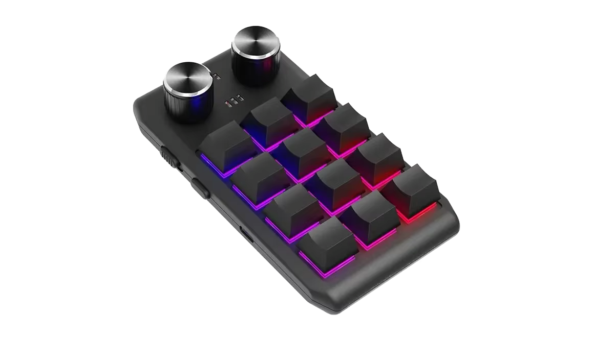

<p align="center"></p>

<h1 align="center">브라우저용 매크로 키보드 설정 도구</h1>

<p align="center">
  
  
  
  <a href="../LICENSE"></a>
</p>

<p align="center"><a href="../README.md">English</a> · <b>한국어</b> · <a href="README.de.md">Deutsch</a> · <a href="README.es.md">Español</a> · <a href="README.fr.md">Français</a> · <a href="README.id.md">Bahasa Indonesia</a> · <a href="README.it.md">Italiano</a> · <a href="README.ja.md">日本語</a> · <a href="README.pl.md">Polski</a> · <a href="README.pt-BR.md">Português (Brasil)</a> · <a href="README.vi.md">Tiếng Việt</a> · <a href="README.zh-Hans.md">简体中文</a> · <a href="README.zh-Hant.md">繁體中文</a></p>

884x 계열의 작은 USB 매크로 키보드에 브라우저에서 WebHID 로 키 설정을 쓰는 웹 부품입니다. 설치할 것이 없습니다. 키와
노브의 동작(왼쪽으로 회전 · 누르기 · 오른쪽으로 회전)마다 레이어 1–3 에 키 입력 · 멀티미디어 키 · 마우스 동작을 정하고,
키보드의 조명도 정합니다. 같은 규칙으로 만든 macOS · Windows · 리눅스 앱의 브라우저 판이고, 같은 명령을 씁니다.

<p align="center"></p>

| 키보드 | 배열 | 읽어 오기 | 지연 | 조명 | 실기 확인 |
|---|---|---|---|---|---|
| 제조사 `1189` 또는 `514C`, 제품 `8840` · `8842` · `8830`–`8833` · `8850` · `8851`, 새 펌웨어 | 키보드가 알려 준 대로 — 26가지 | 연결하면 바로 | 입력마다 | 모드 하나와 키 1–16 의 색 | 했음 — `514C:8850`, 키 12개 · 노브 둘 |
| 같은 키보드, 옛 펌웨어 | 키보드가 알려 준 대로 | 연결하면 바로 | 키마다 하나 | 색과 모드 | 안 했음 |
| 같은 키보드, 종류를 알려 주지 않는 것 | 사용자가 고름 — 26가지 | 안 됨 | 없음 | 색과 모드 | 안 했음 |

모두 제조사의 여러 운영체제용 앱 "MINI_KEYBOARD" 가 찾는 키보드입니다. 대개 키와 노브가 몇 개인지, 펌웨어가 무엇인지
알려 주므로 제조사 앱이 그리는 배열을 그대로 그리고, 알려 주지 않는 키보드는 그 배열 가운데 사용자가 고른 것을 씁니다.

제조사의 Windows 설정 도구 "MINI KeyBoard" 가 다루는 `1189:8890` 은 브라우저에서 다룰 수 없습니다. 설정 통로에 OUT
엔드포인트만 있어서 macOS 와 리눅스가 HID 장치로 만들지 않고, 브라우저는 웹 페이지가 HID 클래스의 USB 인터페이스에 닿지 못하게
막습니다. 이 키보드는 아래의 앱으로 설정하세요.

앱은 13개 언어로 나옵니다 — 영어 · 한국어 · 일본어 · 중국어(간체 · 번체) · 독일어 · 스페인어 · 프랑스어 · 이탈리아어 ·
포르투갈어(브라질) · 폴란드어 · 인도네시아어 · 베트남어. 앱이 들어 있는 페이지의 언어를 따르고, 그 밖의 언어에서는 영어로
나옵니다.

이 저장소의 소스는 MIT 라이선스입니다. 맨 위의 아이콘은 보여 주려고 둔 것으로 MIT 가 아니라 CC BY-SA 4.0 이고
([`LICENSES/CC-BY-SA-4.0.txt`](../LICENSES/CC-BY-SA-4.0.txt)), 이 저장소의 빌드에는 들어가지 않습니다.

## macOS · Windows · 리눅스 · 웹

MINIKeyboard 는 같은 규칙으로 만든 네 판이 있습니다 — 같은 명령, 같은 13개 언어. 세 앱은 같은 키보드를 다루고, 브라우저에서 도는 웹판은 그 가운데 `1189:8890` 을 뺀 키보드를 다룹니다.

| 저장소 | GitHub |
|---|---|
| **MINIKeyboardApple**<br>    | [github.com/hobbyworker/MINIKeyboardApple](https://github.com/hobbyworker/MINIKeyboardApple) |
| **MINIKeyboardWin**<br>    | [github.com/hobbyworker/MINIKeyboardWin](https://github.com/hobbyworker/MINIKeyboardWin) |
| **MINIKeyboardLinux**<br>    | [github.com/hobbyworker/MINIKeyboardLinux](https://github.com/hobbyworker/MINIKeyboardLinux) |
| **MINIKeyboardWeb**<br>    | [github.com/hobbyworker/MINIKeyboardWeb](https://github.com/hobbyworker/MINIKeyboardWeb) |

## 어디서 도나

이 저장소에는 소스만 있습니다 — 릴리스나 올려 둔 페이지는 없습니다. 앱은 페이지에 끼워 넣는 사용자 정의 요소
`<minikeyboard-app>` 입니다([끼워 넣기](#끼워-넣기)). 판마다 `web/v<판>` 태그를 답니다.

- Windows · macOS · 리눅스의 Chromium 계열 브라우저 — Chrome · Edge 등. Firefox 와 Safari 에는 WebHID 가 없습니다.
- 페이지는 HTTPS 로, 또는 `localhost` 에서 열려야 합니다.
- 드라이버가 필요 없습니다. 제조사 앱처럼 키보드의 첫 USB 인터페이스로 쓰고, 그동안에도 키보드는 그대로 입력됩니다.
  리눅스에서는 키보드의 hidraw 장치에 udev 규칙이 필요합니다. 앱의 **허용하는 방법…** 에서 보여 줍니다.

## 쓰는 법

1. 키보드를 꽂고 **키보드 연결…** 을 누른 뒤, 브라우저가 보여 주는 목록에서 키보드를 고릅니다. 브라우저가 그 선택을 사이트마다
   기억하므로 다음부터는 앱이 키보드를 스스로 엽니다. 앱은 키보드에 종류를 묻고, 종류를 알려 주면 바로 읽어 옵니다.
2. 모양을 알려 주지 않는 키보드는 처음에 배열 — 제조사 앱의 배열 가운데 하나 — 과 앞에 놓인 방향을 정합니다. 앱은 이
   브라우저에서 USB ID 마다 기억합니다. 나중에 **모양…** 과 **회전**으로 바꿉니다. 모양을 알려 준 키보드는 돌리기만 합니다.
3. 레이어를 고르고, 키보드 그림에서 키나 노브 동작을 고릅니다.
4. 동작을 줍니다.
   - **키** — 보조 키를 잡고 키를 누릅니다. 누를 때마다 입력이 하나씩 붙습니다. **보조 키만** 은 그 키를 보조 키로 만듭니다.
     **QWERTY** 는 키를 풀사이즈 키보드처럼, **ABC** 는 묶음으로 늘어놓습니다. 키보드가 받는 키만 누를 수 있습니다.
   - **멀티미디어** · **마우스** — 키에 있던 동작을 대신합니다.
   - **LED** — 레이어의 조명. 새 펌웨어는 키 1–16 가운데 하나를 골라 색을 줍니다.
   - **지연** — 지연을 기억하는 펌웨어에서.
5. **저장** 이 바뀐 것을 쓰고, 다시 읽어 키보드가 쓴 대로 받았는지 확인합니다. **읽기** 는 키보드에서 지금 설정을 가져옵니다.

메뉴(☰)의 **장치 기록** 은 키보드에 쓴 리포트와 받은 답을 모두 키보드 그림 아래에 보여 주고, **시뮬레이터** 는 그 키보드
없이 앱을 써 보게 합니다 — 같은 명령을 쓰되 USB 로는 아무것도 보내지 않고, 키보드가 꽂힌 것처럼 동작합니다. 허락한 키보드
여러 대가 꽂혀 있으면 연결 상태 옆의 단추로 열 키보드를 고릅니다.

## 끼워 넣기

```html
<script type="module" src="/path/to/minikeyboard.js"></script>
<minikeyboard-app lang="ko"></minikeyboard-app>
```

| 속성 | |
|---|---|
| `lang` | 페이지의 언어 — `en` · `ko` · `ja` · `zh-hans` · `zh-hant` · `es` · `pt` · `fr` · `de` · `it` · `pl` · `id` · `vi` (`ko-KR` · `zh-TW` 같은 지역 꼴도 됩니다). 그 밖에는 영어입니다. 없으면 페이지의 것 — 요소나 그 조상(`<html>` 까지)의 `lang` 을 따릅니다. |
| `theme` | `light` 또는 `dark`. 없으면 페이지의 다크 모드 — `<html>` 이나 `<body>` 의 `data-theme`(Hugo FixIt 처럼), `dark` 클래스, 인라인 `color-scheme` — 를, 그것도 없으면 시스템을 따릅니다. |

앱은 shadow root 에 그리므로 페이지의 스타일과 앱의 스타일이 섞이지 않고, 글꼴은 페이지의 것을 물려받습니다. 앱에는 이름 ·
아이콘 · 링크가 없습니다 — 그것은 페이지의 몫입니다. 언어마다의 문구는 `minikeyboard.js` 옆의 파일이고, 그 언어를 고를 때
`minikeyboard.js` 를 기준으로 불러옵니다 — `dist/` 폴더를 통째로 함께 올리세요.

자기 빌드에서 앱에 덧붙일 수도 있습니다. `src/app/index.ts` 의 `MiniKeyboardElement` 를 상속해 `footer()` 에서 Svelte 컴포넌트를 돌려주면 앱의 맨 아래에 앱의
색과 지금 언어로 그려지고, 그 클래스는 `defineMiniKeyboard()` 로 등록합니다.

앱은 일어난 일을 페이지에 알립니다. 연결 · 읽기 · 저장 · 장치 허용의 답 · 문제가 있을 때마다 `minikeyboard` 이벤트를 보내고(버블링하며 shadow root
밖까지 나옵니다), `detail.action` 은 `connect` · `read` · `save` · `access` · `problem` 가운데 하나입니다. 키보드의 종류와
결과만 담고 키에 무엇을 넣었는지는 담지 않습니다. 앱 자신은 어디로도 아무것도 보내지 않습니다.

## 빌드

Node 22 이상.

```sh
npm install
npm run dev     # 개발 페이지 http://localhost:5180
npm test        # 키보드에는 닿지 않습니다
npm run check   # 서식 · 형 검사, 그리고 레이어마다 들여도 되는 것만 들이는지
npm run build   # dist/
```

## 구조

규칙은 레이어에 있습니다. 의존은 안쪽으로만 향하고, 바깥으로 손을 뻗는 레이어가 있으면 `scripts/check-layers.mjs` 가 검사를
실패시킵니다.

```
src/
├── domain/        키보드 · 동작 · 배열의 컨트롤 · 키보드마다 담을 수 있는 것, 포트, 유스케이스 (가져오는 것 없음)
├── data/          키보드마다의 명령과 컨트롤의 번호, WebHID, 시뮬레이터 키보드, 브라우저가 기억하는 것
├── presentation/  뷰모델과 화면이 그리는 값 — 배열의 그림, 키 · 색 표 (UI 프레임워크 없음)
├── ui/            Svelte 5 — presentation 만 본다. 언어마다의 문구 표(l10n/)
└── app/           <minikeyboard-app> 과 조립(composition root) — 모두를 아는 유일한 곳
tests/             vitest — 명령의 바이트, 배열, 편집, 편집기
LICENSES/          맨 위 아이콘의 라이선스 (CC BY-SA 4.0)
```

경고 0 이 기준입니다. 경고는 끄지 않고 고칩니다.

## 한계

- 쓰기는 지금까지 키보드 한 대, 키 12개 · 노브 둘의 `514C:8850` 으로 macOS 의 Chrome · Windows 11 의 Edge · 리눅스의 Chromium
  에서 확인했습니다. 나머지 키보드는 제조사 앱이 쓰는 대로 씁니다 — 명령은 앱들의 것과 바이트까지 같고 테스트가 지키지만,
  실기로는 아직 확인하지 못했습니다.
- 종류를 알려 주지 않는 키보드는 지금 설정을 알려 주지 않으므로, 앱에서 정한 것만 보입니다.
- 한 번에 키보드 하나.
- 마우스 이동과 끌기는 없습니다.

## 라이선스

MIT — [LICENSE](../LICENSE) 를 보세요. 맨 위의 아이콘은 CC BY-SA 4.0 — [LICENSES/CC-BY-SA-4.0.txt](../LICENSES/CC-BY-SA-4.0.txt) 를 보세요.
